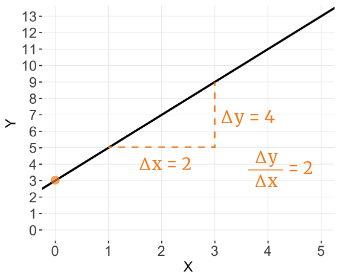

# Pose pose pose

Modelado de datos == Encontrar la relacion matematica en el dataset

Queremos describir como cambia una variable cuando cambia la otra

## Utilidad del modelado

- Resumir: **comprimir** muchos datos en pocos numeros.
  - Como varia `variable1` con `variable2`?
- Cuantificar: ponerle **numeros** a una relacion.
  - Por cada `variable1`, cuanto cambia `variable2`?
- Inferir: evaluar si la relacion **es real** o ruido.
  - La relacion es significativa o producto al azar?
- Controlar: **aislar** el efecto de una variable eliminando otras
- Predecir: **estimar** valores nuevos

## Familia de modelos

- Lineal
- Regresion logistica
- Arbol de decision
- Red neuronal

### Modelo lineal simple

```latex
Y = a . X + b + ε
```

Donde



## RMSE

### Modelo lineal multiple

```latex
Y = a . X₁ + b₂ + c + ε
```

## Analisis de residuos

Un modelo correcto te deja una nube de puntos sin estructura alrededor del eje horizontal.

Un modelo incorrecto

- Pasa si los residuos se dispersan, la varianza del error no es constante
- Si existe algun tipo de patron, hay algo que el modelo no captura

En la practica, no es realmente obvio.

### Heterocedasticidad

> Cuando la dispersion de los residuos crece con el valor predicho

Para mitigar el problema podes usar `log(x)` en vez de `x`

## Funcion `lm`

En la funcion `lm`, `~` separa a la variable _objetivo_ de la variable _explicativa_

Notese que además de la fórmula, hay que pasar el dataset que usamos para el ajuste en el argumento data. Con esta sintaxis, lo que estamos haciendo es ajustar un modelo de la forma:

```latex
Petal.Width = 𝑎 + 𝑏 ⋅ Petal.Length
```

La tarea de la función `lm` es encontrar el valor de los parámetros `a` y `b` que “mejor ajustan” los datos.

|              | Estimate Std. | Error  | t value | Pr(>\|t\|) |
| ------------ | ------------- | ------ | ------- | ---------- |
| (Intercept)  | -0.08429      | 0.1607 | -0.5245 | 0.60234    |
| Petal.Length | 0.33105       | 0.0375 | 8.8280  | 0.00000    |

En esta sección, tenemos una fila por parámetro, y para cada parámetro tenemos cuatro valores y, eventualmente, un simbolito:

- `Estimate`: el valor del parámetro que mejor ajusta los datos.
- `Std. Error`: el desvío del estimador. Es decir, el rango dentro del cual se puede mover el valor de los parámetros sin que el ajuste cambie mucho (estamos siendo, a propósito, muy poco formales con estas definiciones, que ya van a ver con lujo de detalles en otras materias).
- `t value`: el valor t, que no es más que el cociente entre el valor del estimador y su desvío (pruébenlo).
- `Pr(>|t|)`: un `p` valor asociado con este valor `t`, que nos da una probabilidad. ¿Probabilidad de qué? Ah, es un trabalenguas, pero la respuesta es “la probabilidad de que, si no existe una relación entre ambas variables, hayamos obtenido este valor `t` (o uno más extremo) por azar”.
- Por último, tenemos los códigos de significancia, que aparecen como estrellitas en cada fila, para indicar cuán significativo es cada parámetro. El código depende del `p` valor, según lo que está definido abajo.

- **Residual standard error:** una forma de medir la dispersión de los residuos.
  - 3.836 on 232 degrees of freedom: la predicción se desvia +- 3.8  

- **R² ajustado:** proporción de variabilidad total de hwy explicada por el modelo.
  - Multiple R-squared: 0.5868, Adjusted R-squared: 0.585
    - casi un 59% de la variabilidad en los datos de hwy se puede atribuir a la cilindrada)
    - ver para detalles ([https://www.datacamp.com/es/tutorial/adjusted-r-squared](https://www.datacamp.com/es/tutorial/adjusted-r-squared))  

- **F-statistic:** compara el modelo actual contra uno sin predictores.
  - F-statistic: 329.5 on 1 and 232 DF, p-value: < 2.2e-16  
        Mide si la mejora es estadisticamente significativa contra el modelo que sólo tiene el intercepto (valores más grandes es “mejor”, p chico es “mejor”)

### Modificadores de la funcion

In R, the `lm()` (linear model) function does not use "modifiers" as separate arguments; instead, you modify the model's behavior using **formula operators**, **built-in functions within the formula**, or **specific arguments** inside `lm()`.

The most common ways to modify a linear model in R include:

1. Formula Operators (Interaction & Interaction Modifiers)

These operators change how variables interact with each other inside the `formula = y ~ x` argument:

- **`:` (Interaction only):** `y ~ x1:x2` includes _only_ the interaction term between `x1` and `x2`, excluding their individual main effects.

- **`*` (Cross/Interaction):** `y ~ x1 * x2` is shorthand for `y ~ x1 + x2 + x1:x2`. It includes both main effects and their interaction.

- **`^n` (Factorial crossing to a specific degree):** `y ~ (x1 + x2 + x3)^2` expands to all main effects and all 2-way interactions, but excludes the 3-way interaction.

- **`-` (Removal):** Removes a term.
  - `y ~ x1 + x2 - x1` removes `x1`.
  - `y ~ x1 * x2 - x1:x2` removes the interaction term.
  - `y ~ x1 - 1` or `y ~ x1 + 0` **removes the intercept**.

1. Math & Protection Modifiers

If you want to perform mathematical operations on a predictor before fitting, standard R operators (`+`, `*`, `^`) will conflict with the formula syntax. You must protect or transform them:

- **`I()` (Inhibit/As-Is):** Protects arithmetic operators so they are treated mathematically.
  - `y ~ I(x1 + x2)` adds `x1` and `x2` together as a single predictor.
  - `y ~ x + I(x^2)` creates a quadratic polynomial regression.

- **`poly(x, degree)`:** Creates orthogonal or raw polynomials. `y ~ poly(x, 2)` is a cleaner, more stable way to fit a quadratic model than using `I(x^2)`.

- **`log()`, `exp()`, `sqrt()`:** Standard mathematical transformations can be wrapped directly around variables (e.g., `log(y) ~ x`).

1. Categorical & Data Grouping Modifiers

- **`factor(x)`:** Forces a numeric or character variable to be treated as a categorical variable (factor), generating dummy variables automatically.

- **`relevel(factor(x), ref = "Group")`:** Changes the baseline/reference group for a categorical variable in the regression output.

1. Built-in `lm()` Function Arguments

You can pass specific arguments into `lm()` to alter how the model handles data weights, subsets, or missing values:

| Argument        | Description                                                                          | Example                          |
| --------------- | ------------------------------------------------------------------------------------ | -------------------------------- |
| **`weights`**   | Fits a Weighted Least Squares (WLS) regression to handle heteroscedasticity.         | `lm(y ~ x, weights = 1/w)`       |
| **`subset`**    | Specifies a subset of observations to be used in the fitting process.                | `lm(y ~ x, subset = age > 18)`   |
| **`na.action`** | Determines how missing values (`NA`) are filtered (e.g., `na.omit` or `na.exclude`). | `lm(y ~ x, na.action = na.omit)` |
| **`offset`**    | Includes a variable with a fixed coefficient of 1 (often used in rate models).       | `lm(y ~ x + offset(z))`          |

## en las diapo

y negado es media de y
